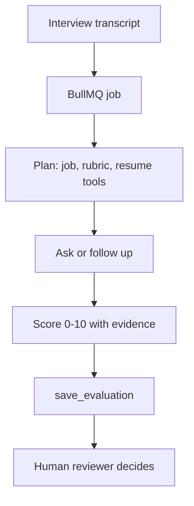

# Architecture

## Agent framework

The scoring agent uses **OpenAI Chat Completions function calling**, not the Agents SDK or LangGraph.js.

This product has one loop: plan, ask or follow up, call four tools, score, stop. A single HTTP call with a step counter is enough. It is easy to cap, time out, retry, and replace with the deterministic fallback in tests and in `npm run eval`. The Agents SDK and LangGraph add a runtime we would not use.

When `OPENAI_API_KEY` is unset or the call fails, `Backend/agent/fallback.js` still runs the same tool sequence and returns a Zod-validated score. Candidate names are not an input to that scorer.

## Flow

## Design decisions

- **Queue.** Transcription and scoring are slower than an HTTP request should be. The API stores a job id and a worker updates status. In tests, and when Redis is down, the same function runs inline so the contract stays the same.
- **Structured output.** Scores must match a Zod schema: category, 0-10 score, reasoning, and a quote. Invalid model JSON is discarded and the fallback result is validated instead.
- **Human decision.** `recommendation` is advice. `humanDecision` stays empty until an admin sends a decision.
